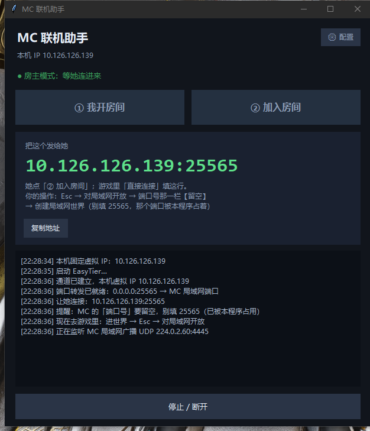

# MC 联机助手

> 两个人远程玩 Minecraft Java 版，谁都能当房主，不用开服务器，不用公网 IP，朋友没有正版也能进。

<p align="center">
  
</p>

<p align="center">
  
</p>

---

## 它解决什么问题

Minecraft 的「对局域网开放」只能同一局域网里玩，而且：

- 每次开放都会**随机换一个端口**，世界一重开就变，对方每次都得重新问
- 公网 IP、路由器的端口映射，大部分人都没有
- 直接开 `server.jar` 默认又是 `online-mode=true`，没有正版的朋友进不去

这个工具做两件事：

1. **把两台机器拉进同一个虚拟局域网**（靠 [EasyTier](https://github.com/EasyTier/EasyTier)，P2P 打洞优先，打不通才走中继）
2. **把 MC 那个随机端口固定成 `25565`**，于是对方永远只连 `虚拟IP:25565`

界面上一左一右两个按钮，**谁点「我开房间」谁就是房主**，角色随时可以换。

## 特性

- 🔁 **双向**：同一份程序，两边都能当房主
- 📌 **地址固定**：端口转发把随机端口固定下来，不用每次问
- 🔍 **自动发现**：加入方自动找到房主 IP 并填好，不用手抄
- 🎮 **支持离线账号**：走的是「对局域网开放」，本来就是离线模式
- 🪟 **无控制台闪窗**：所有子进程都带 `CREATE_NO_WINDOW`
- 📦 **零依赖**：只用 Python 标准库 + tkinter

## 原理

```
 ┌──────────┐        ┌──────────────┐        ┌──────────┐
 │  房主 PC  │◄──────►│  EasyTier    │◄──────►│  客人 PC  │
 │          │  虚拟  │  中继 / P2P   │  虚拟  │          │
 │ MC:51234 │  局域网 │  11010        │  局域网 │  直接连接 │
 │    ▲     │        └──────────────┘        │  :25565  │
 │  转发     │                                └──────────┘
 │ :25565   │
 └──────────┘
```

- `mc-lan-helper.py` 监听 MC 的局域网广播（UDP `224.0.2.60:4445`），读出这次随机开的端口，
  再在本机 `25565` 上做 TCP 转发。广播收不到时会退回到 `netstat` 扫描。
- `mclink.py` 管 EasyTier 进程和界面，并复用上面的转发实现。

## 快速开始

### 1. 准备依赖

去 [EasyTier Releases](https://github.com/EasyTier/EasyTier/releases) 下载 **Windows x86_64** 压缩包，
把这几个文件解压到本项目目录（和 `mclink.py` 同级）：

```
easytier-core.exe
easytier-cli.exe
wintun.dll
Packet.dll
WinDivert64.sys
```

> 这些二进制不属于本项目，所以没有提交进仓库。

还需要 **Python 3.9+**（安装时勾上 `Add python.exe to PATH`）。

### 2. 准备一个中继节点

EasyTier 需要一个双方都能连上的节点来做握手/中转。三种方式：

| 方式 | 说明 |
|---|---|
| **自己的云服务器** | 最稳，见下方「自建中继」 |
| **公网 IP 直连** | 任意一方有公网 IP，`relay` 直接填 `tcp://公网IP:11010` |
| **别人的共享节点** | 网上找现成的，稳定性不保证 |

> ⚠️ 官方曾经提供的 `public.easytier.cn` 目前已经解析不到了，别照老教程填。

### 3. 填写 config.json

把 `config.example.json` 复制成 `config.json`，改这三项：

```json
{
  "network_name": "自己现编一个，两台机器必须一致",
  "network_secret": "自己现编一个，两台机器必须一致",
  "relay": "tcp://你的中继地址:11010",
  "vpn_prefix": "10.126.126.",
  "bridge_port": 25565
}
```

| 字段 | 说明 |
|---|---|
| `network_name` | 网络名，**两台机器必须相同** |
| `network_secret` | 网络密钥，**两台机器必须相同**；等于这张局域网的身份证 |
| `relay` | 中继节点地址，形如 `tcp://1.2.3.4:11010` |
| `vpn_prefix` | 虚拟 IP 前三段，默认 `10.126.126.` |
| `bridge_port` | 对外固定端口，默认 `25565` |

`config.json` 会被 git 忽略，**不要把带密钥的它提交到任何地方**。

### 4. 运行

双击 `启动.bat`（或 `pythonw mclink.py`）。第一次会弹 UAC —— 创建虚拟网卡必须管理员权限，点「是」。

### 5. 开始玩

| 谁 | 点什么 | 之后 |
|---|---|---|
| 房主 | **① 我开房间** | 进世界 → `Esc` → 对局域网开放 → **端口号留空** |
| 客人 | **② 加入房间** | 等地址出现 → 多人游戏 → 直接连接 → 粘进去 |

**「端口号」那一栏必须留空**。因为它已经被本程序的转发占用了，游戏自己再绑 `25565` 会提示「端口不可用」。
填别的数字也行，留空最省事。

## 自建中继

一台 1 核 1G 的小机器就够。以 Ubuntu 为例：

```bash
# 下载 Linux 版并解压到 /opt/easytier
mkdir -p /opt/easytier
cd /tmp && curl -LO https://github.com/EasyTier/EasyTier/releases/download/v2.7.0/easytier-linux-x86_64-v2.7.0.zip
python3 -m zipfile -e easytier-linux-x86_64-v2.7.0.zip /opt/easytier
```

`/etc/systemd/system/easytier-relay.service`：

```ini
[Unit]
Description=EasyTier relay node
After=network-online.target
Wants=network-online.target

[Service]
Type=simple
ExecStart=/opt/easytier/easytier-linux-x86_64/easytier-core \
  --network-name 你的网络名 \
  --network-secret 你的密钥 \
  --private-mode true \
  --hostname relay
Restart=always
RestartSec=5
LimitNOFILE=1048576

[Install]
WantedBy=multi-user.target
```

```bash
systemctl daemon-reload
systemctl enable --now easytier-relay
```

**别忘了放行端口**：云厂商的安全组要开 **`11010` 的 TCP 和 UDP** 两条入方向规则（授权对象 `0.0.0.0/0`）。
只开 22 端口的话，从外面连 `11010` 会一直超时——这是最容易卡住的一步。

## 常见问题

**Q：MC 里提示「端口不可用，请输入 1024 至 65535」**

`25565` 被本程序的转发占着。把「端口号」清空，或者随便填个别的数字。

**Q：一直有黑色 CMD 窗口在闪**

旧版本的问题：端口扫描子进程没加隐藏窗口参数。当前版本已修复（所有 `subprocess` 调用都带 `CREATE_NO_WINDOW`）。

**Q：点「加入房间」一直找不到房主**

1. 房主那边必须先点「① 我开房间」，状态显示「房主模式」
2. 两台的 `config.json` 里 `network_name` 和 `network_secret` 必须完全一致
3. `relay` 地址要能连通：`ping` 一下，或用 `Test-NetConnection 主机 -Port 11010`

**Q：两个人都不小心点了「① 我开房间」**

两边都在监听同一个端口，会互相看到「对方已上线」但连不进去。点「停止/断开」重来，一开一加。

**Q：日志说「检测到 IP 冲突」**

两台机器分到了同一个虚拟 IP。删掉各自的 `mclink.json` 再重启，程序会重新分配。

**Q：朋友是离线账号，能进吗**

能。「对局域网开放」本身就是离线模式。反过来如果你是用 `server.jar` 开服，记得把
`server.properties` 里的 `online-mode` 改成 `false`。

**Q：连上后很卡**

先看界面上显示的延迟。走中继通常比直连慢；EasyTier 会尝试 P2P 打洞，成功就快。
另外中继服务器的带宽/流量也有限制，MC 传区块是按 MB 算的。

## 目录结构

```
mc-lan-helper/
├── mclink.py            主程序（界面 + EasyTier 管理）
├── mc-lan-helper.py     端口转发（也可单独命令行运行）
├── mclink.ico           图标
├── 启动.bat              启动器
├── config.example.json  配置模板
├── assets/              README 用的图
└── LICENSE
```

## 命令行自检

```bat
python mclink.py --selftest        :: 检查配置 + 通道能否建立
python mclink.py --smoke host     :: 跑一遍房主流程并打印结果
python mclink.py --smoke guest    :: 跑一遍加入流程
```

`mc-lan-helper.py` 也能单独用：

```bat
python mc-lan-helper.py                 :: 固定 25565
python mc-lan-helper.py --listen 25566  :: 换端口
python mc-lan-helper.py --target 51234  :: 手动指定 MC 端口
```

## 免责声明

仅供和朋友一起玩自己的存档。使用中继服务产生的流量、费用和合规问题由使用者自行承担。
EasyTier 与 Minecraft 均为其各自所有者的项目，本项目与它们没有隶属关系。

## License

[MIT](LICENSE) © 2026 AschVer
